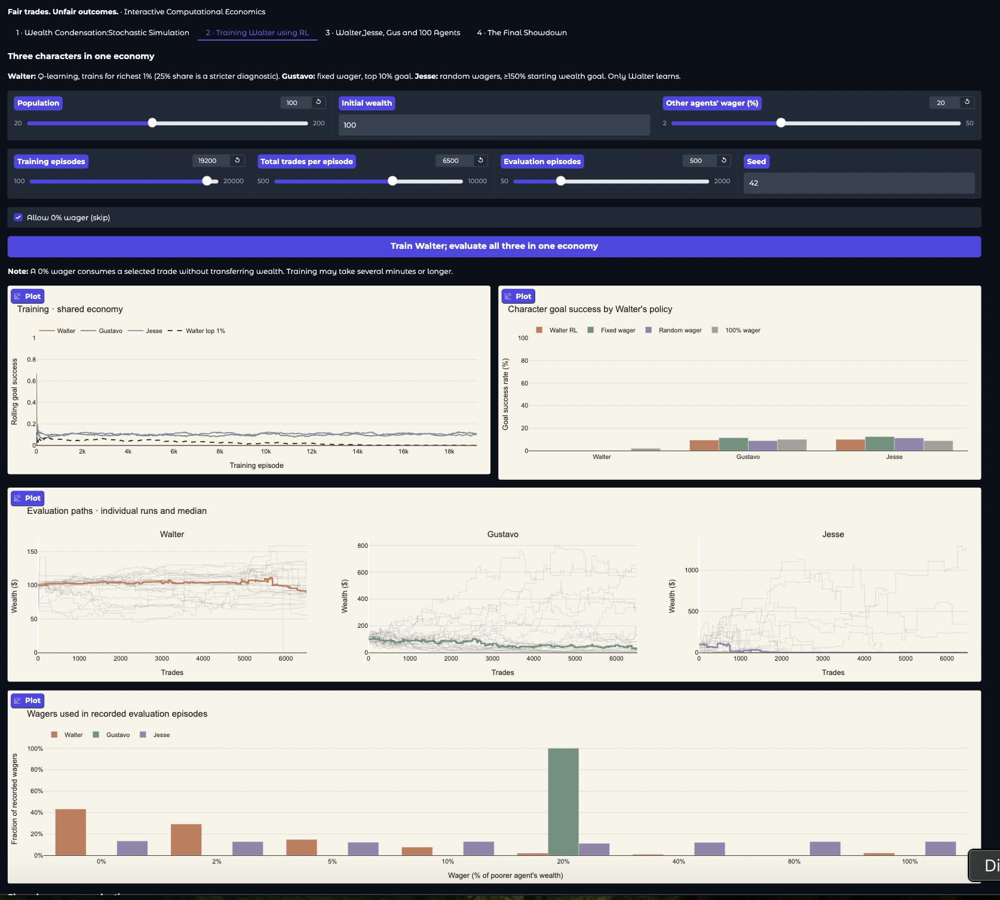
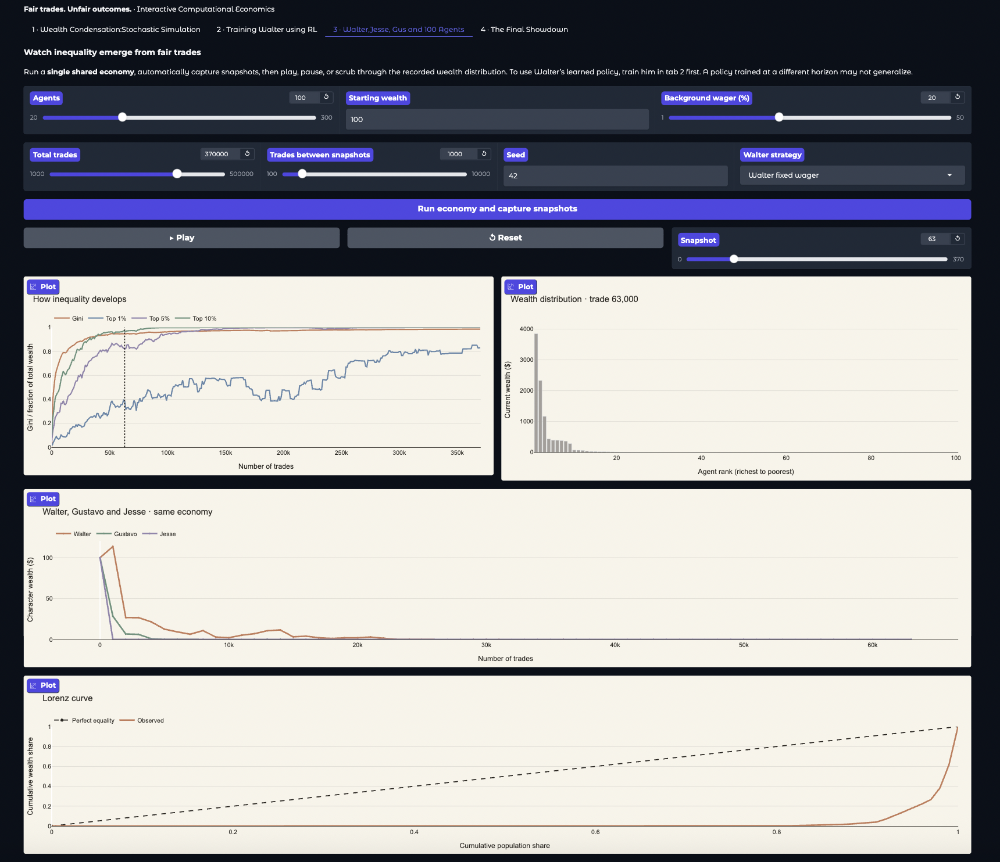
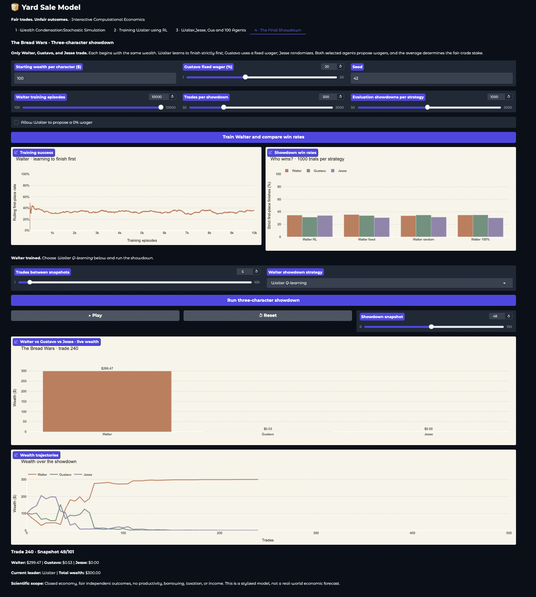

# 🍞 Yard Sale Model

### Fair trades. Unfair outcomes. · Interactive computational economics

A Python simulation lab exploring **wealth condensation**, **fair stochastic exchanges**, and **reinforcement learning** through four interactive experiments. Walter, Gustavo, and Jesse bring different wagering strategies to a world where every coin flip is fair—but wealth can still become highly unequal.

Built with **Python, NumPy, Plotly, and Gradio**.


> **Research question:** Can Walter learn wager choices that improve his probability of reaching a particular wealth goal, even though no strategy changes the 50/50 odds of an individual trade?
>
> **Important:** This repository contains **tabular Q-learning** for the larger shared economy and **tabular Monte Carlo-style updates** for the three-person showdown. **PPO is not implemented in the four-tab app shown here.**

---

## 1. How the Yard Sale Model works


In a closed economy, each person starts with the same wealth. At each **trade**, two different agents are selected at random, and one wins an amount from the other with probability 50%.

For a wager fraction \(\beta\), the amount exchanged is:

$$
\Delta w = \beta\min(w_i,w_j)
$$

If agent \(i\) wins, its wealth increases by \(\Delta w\) while agent \(j\)'s wealth decreases by the same amount; if \(j\) wins, the transfer is reversed.

**Example:** Walter and Jesse each have $100. With a 20% wager, the stake is $20. One ends with $120 and the other with $80. In their next trade, a 20% stake is based on the *poorer* agent's $80, so the stake becomes $16.

The game conserves total wealth, and each individual trade has zero expected transfer. Nevertheless, repeated random exchanges can generate very unequal wealth distributions. Fair *transactions* do not guarantee an equal *distribution*.

The independent stochastic simulation in `src/economy.py` chooses **one random pair per trade**, not a simultaneous round in which everybody trades.

---

## 2. The four dashboard tabs

| Tab | Suggested display name | What it does |
|---|---|---|
| 1 | **Wealth Condensation · Stochastic Simulation** | Runs a standard Yard Sale simulation and examines inequality at selected snapshots. |
| 2 | **Training Walter using RL** | Trains Walter in a larger shared economy and compares four Walter policies. Gustavo and Jesse do not learn. |
| 3 | **Walter, Jesse, Gus and 100 Agents** | Replays one recorded shared economy, highlighting the three characters and the evolving wealth distribution. |
| 4 | **The Final Showdown** | Trains a **separate** Walter policy in a three-person economy and animates the Walter–Gustavo–Jesse contest. |

Tabs 1 and 3 both examine wealth condensation, but **Tab 1 is the general statistical experiment**; **Tab 3 is an animated replay of the character-based economy**. Tabs 2 and 4 both involve Walter learning, but their **populations, trading rules, and learning updates differ**.

### Tab 1 — Wealth Condensation: Stochastic Simulation


Runs `simulate()` in `src/economy.py` with configurable population, starting wealth, wager fraction, number of trades, and random seed.

Displays:

- Gini coefficient and richest-agent wealth share over time.
- Ranked wealth distribution at the selected snapshot.
- Lorenz curve and snapshot statistics.

The **Gini coefficient** ranges from 0 for perfect equality toward 1 for extreme concentration. The model also records the share held by the richest agent.

### Tab 2 — Training Walter using RL



Uses `train_all()` and `evaluate()` from `src/rl_agents_new_strategy.py`.

All characters coexist in the **same simulated town** (100 agents by default):

| Character | Strategy | Reported goal |
|---|---|---|
| **Walter** | Learns a tabular Q-value policy | Finish **strictly in the richest 1%** during training; a **25% share of total town wealth** is tracked separately as a more demanding diagnostic |
| **Gustavo** | Fixed wager (20% by default) | Finish in the top 10%, using the code's conservative tie rule |
| **Jesse** | Random wager from the allowed action set | Finish with at least 150% of starting wealth |
| **Other bakers** | Fixed wager | Background population; no separate learning |

**Only Walter learns.** Gustavo and Jesse are not separate RL models; their success curves are recorded during Walter's training.

#### Walter's observations and actions

Walter's tabular state includes:

1. The fraction of other bakers richer than Walter (binned).
2. Walter's wealth divided by the town's mean wealth (binned).
3. The selected opponent's wealth relative to Walter's (binned).
4. The fraction of the episode completed (binned).

Available wager fractions are **0%, 2%, 5%, 10%, 20%, 40%, 80%, and 100%**. Disabling the *Allow 0% wager* option removes the zero-wager choice from Walter's and Jesse's action sampling. In this tab, choosing 0% results in **no wealth transfer**, but the selected trade still consumes a step.

#### How Walter learns

Walter's larger-economy learner uses **tabular, epsilon-greedy Q-learning-style updates**, with a bounded **intermediate potential-difference shaping signal** and a final top-1% success reward. It is **not** pure terminal-only Monte Carlo learning. The implementation updates Walter's Q-table when Walter next encounters a trade and once at episode end.

An episode contains a configurable number of **total town trades**. Each trade selects one random pair; Walter is **not** guaranteed to trade at every step. The other participants keep their specified fixed or random wager rules.

#### Evaluation

Walter is evaluated with four alternative policies:

- **Learned (`rl`)** — choose from Walter's trained Q-table.
- **Fixed (`baseline`)** — use the configured background wager.
- **Random (`random`)** — draw a wager from the allowed action set.
- **Aggressive (`aggressive`)** — always wager 100%.

Gustavo and Jesse remain in every evaluation economy, regardless of Walter's policy. Therefore, their reported results are **conditional on Walter's strategy**—the comparison columns do not represent four separately trained character models.

Plots show rolling training success, recorded evaluation wealth paths, observed wager frequencies, and each character's goal-success rate under each Walter policy. The evaluation also calculates wealth rank, wealth shares, Gini, and top-wealth concentration metrics.

**Interpretation caution:** The evaluation policies use different seeded random streams; the current implementation does **not** guarantee paired, identical coin flips and matchups across policy alternatives. It does not calculate confidence intervals or train across multiple seeds automatically. A learned policy is not guaranteed to outperform the baselines.

### Tab 3 — Walter, Jesse, Gus and 100 agents



Uses `simulate_condensation()` in `src/rl_agents_new_strategy.py` and `condensation_animation_charts()` in `src/plots.py`.

Runs **one new shared-economy simulation**, saves periodic snapshots, and lets you play, pause, reset, or scrub through:

- Gini and top 1%, 5%, and 10% wealth shares.
- Ranked wealth distribution, highlighting Walter, Gustavo, and Jesse.
- All three characters' wealth trajectories.
- Lorenz curve and current wealth statistics.

Choose Walter's learned, fixed, random, or 100% wager strategy. **Train Walter in Tab 2 before selecting his learned policy**. A policy trained at a different population or horizon may not generalize reliably; the UI warns about horizon differences but does not enforce matching parameters for this tab.

### Tab 4 — The Final Showdown

Uses `train_showdown()`, `evaluate_showdown()`, and `simulate_showdown()` from `src/rl_agents_new_strategy.py`.

This is a **separate three-person experiment**, with **no background agents**. Walter, Gustavo, and Jesse start with equal wealth:

- **Walter** trains a fresh Q-table to finish **strictly first**.
- **Gustavo** always proposes the configured fixed wager.
- **Jesse** proposes a random wager.

In contrast to Tabs 1–3, **both selected bakers propose a wager**, and the effective fraction is the **average of their two proposals**:

$$
\beta_{\mathrm{effective}} = \frac{\beta_i+\beta_j}{2}, \qquad
\Delta w = \beta_{\mathrm{effective}}\min(w_i,w_j)
$$

The winner is still determined by a fair 50/50 coin flip. A **0% proposal by Walter does not cancel a trade** when the other participant proposes a positive wager.

Walter observes his wealth relative to Gustavo and Jesse, which opponent he faces, and episode progress. Training uses **terminal binary rewards**: 1 for a strict first-place finish, otherwise 0. Each recorded Walter decision receives a constant-step-size **Monte Carlo-style update** from the final outcome.

The tab provides:

- Walter's rolling training first-place rate.
- Repeated-showdown first-place rates for Walter, Gustavo, and Jesse under four Walter policies.
- An animated three-bar wealth chart and wealth trajectories.

The learned showdown policy must be trained **in Tab 4**; it is not interchangeable with the Tab 2 Q-table. The app requires matching horizon, initial wealth, and Gustavo wager for learned showdown playback.

---

## 3. Running locally

### Clone and enter the project

```bash
git clone https://github.com/amulya-prasad/yard-sale-model.git
cd yard-sale-model
```

### Create and activate a virtual environment

**macOS / Linux**

```bash
python3 -m venv .venv
source .venv/bin/activate
```

**Windows (PowerShell)**

```powershell
python -m venv .venv
.venv\Scripts\Activate.ps1
```

### Install dependencies and launch

```bash
pip install -r requirements.txt
python app.py
```

Open **http://127.0.0.1:7860** in your browser. Training can take several minutes or longer, depending on episode count, town size, and number of evaluation trials.

### Optional: run the shared-economy script directly

```bash
python -m src.rl_agents_new_strategy
```

Its `__main__` block trains Walter, evaluates the characters, simulates long-run wealth condensation, prints summary statistics, and writes `wealth_condensation_snapshots.npz` to the working directory. This can be computationally expensive.

---

## 4. Project structure

```text
yard-sale-model/
├── app.py                       # Four-tab Gradio dashboard
├── README.md
├── requirements.txt
├── .gitignore
├── src/
│   ├── __init__.py
│   ├── economy.py               # Fair trades, Gini, basic simulation
│   ├── rl_agents_new_strategy.py # Shared-economy RL and three-person showdown
│   └── plots.py                 # Plotly visualizations
└── assets/
    ├── yard_sale_poster.png
    ├── fair_trades_illustration.png
    ├── stochastic_sim.png
    └── rl_agents.png
```

The structure above lists the files used by the provided application. Additional folders (such as `tests/` or `outputs/`) may exist in your checkout; they are not required by the code shown here.

---

## 5. Experimental assumptions and limitations

- **Closed economy:** No production, income, borrowing, taxation, or injection of new wealth.
- **Fair coin flips:** Each selected trade has an independent 50/50 winner; the strategy changes the **stake**, not the probability of winning.
- **Conserved wealth:** Each transfer adds and subtracts the same amount. The basic simulation explicitly checks conservation at the end.
- **Random pair selection:** Tabs 1–3 use one random pair per trade, **not** a perfect matching of every baker in each round.
- **Different wager convention in Tab 4:** The three-person showdown averages both participants' proposed wagers; it should not be treated as the same trading protocol as the larger economy.
- **Different learning algorithms:** The shared-economy Walter uses intermediate shaping and Q-learning-style bootstrapping; showdown Walter uses terminal-outcome Monte Carlo-style updates.
- **Different goals:** Walter's Tab 2 training reward is a strict top-1% finish. His 25%-of-total-wealth outcome is a separately reported diagnostic. Tab 4 trains for strict first place among three.
- **Ties matter:** The code defines success using explicit strict or conservative comparisons. At very low wealth levels, floating-point precision can also matter.
- **Statistical uncertainty:** Results vary with seeds and simulation settings. Current evaluation reports empirical rates but no confidence intervals or multi-seed training summaries.
- **No promised RL advantage:** Fair trades remain fair in expectation. A policy may alter the probability of reaching a threshold without increasing expected wealth, and may perform worse than simple baselines.
- **Model, not forecast:** The Yard Sale Model is a deliberately stylized computational experiment, not a prediction of real-world economic outcomes.

---

## 6. Possible next experiments

- Run multiple training seeds and report confidence intervals for goal success.
- Compare policies using paired pre-generated matchups and coin-flip streams.
- Compare Q-learning and PPO under a genuinely identical environment and reward definition.
- Examine sensitivity to the ability to wager 0%.
- Explore larger populations, alternative exchange rules, and models with external wealth flows.

---

## Author

**Amulya Prasad**  
Independent computational experiments in economics, mathematics, and physics using AI.

*An exploration of how randomness, incentives, and repeated interactions shape the distribution of wealth.*
