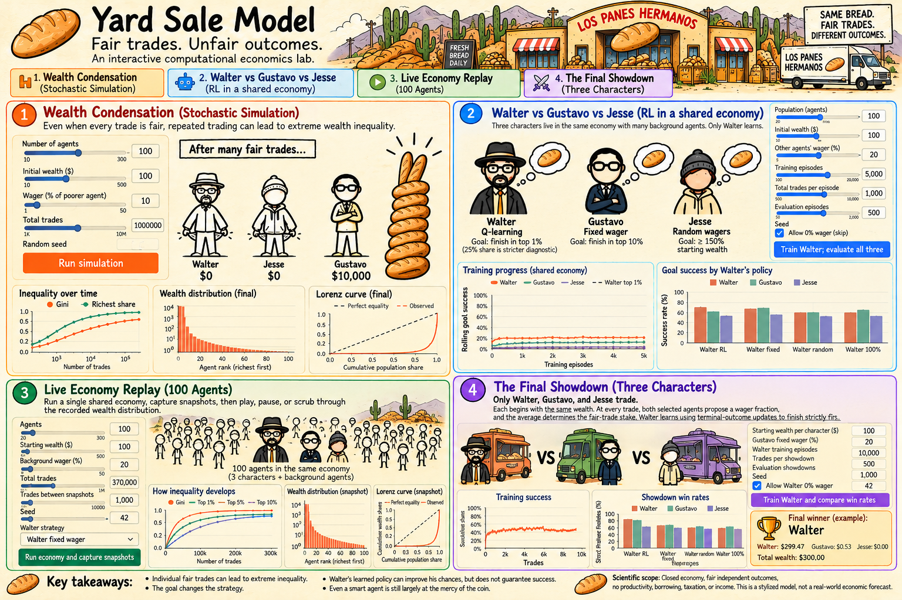
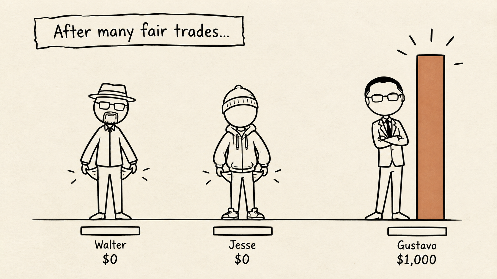
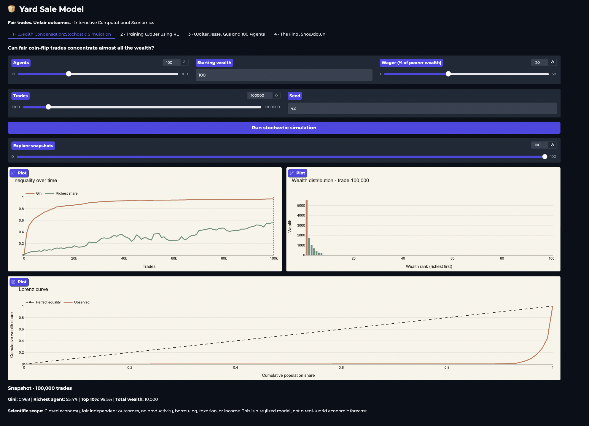
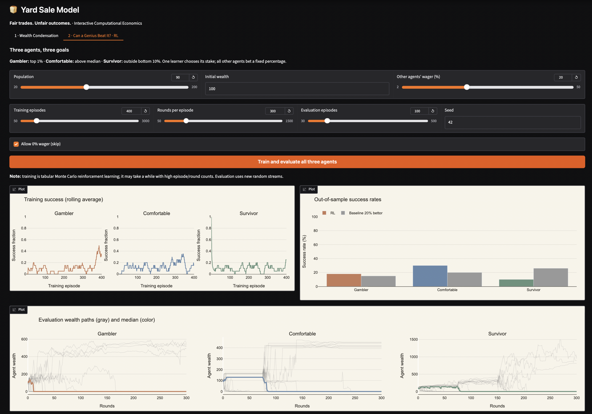

# The Yard Sale Model
### How Fair Trades Can Create Extreme Wealth Inequality

An independent computational economics project exploring **wealth condensation, stochastic trade, and reinforcement learning** through interactive simulations.

What happens when everyone starts with the same amount of money, every transaction is fair, and nobody has an advantage?

Surprisingly, wealth can still become extremely concentrated.

This project explores that phenomenon using the **Yard Sale Model (YSM)** and investigates whether reinforcement learning agents can discover strategies that improve their chances of financial success.

Built with **Python, NumPy, Plotly, and Gradio**.

---

## The Big Picture



Imagine an economy in which:

- Everyone begins with equal wealth.
- Two people are randomly selected to trade.
- Each has a 50% chance of winning.
- The amount exchanged depends on the poorer person's wealth.
- No new money enters the economy.

Even though every transaction is fair, repeated random trades can produce highly unequal outcomes.

**Fair transactions do not necessarily produce fair distributions of wealth.**

---

## 1. The Yard Sale Model



The Yard Sale Model is a stochastic wealth-exchange model.

At every step, two agents are randomly selected to trade.

The amount at stake is:

$$
\Delta w = \beta \min(w_i,w_j)
$$

Where:

- $w_i$ = Wealth of agent i
- $w_j$ = Wealth of agent j
- $\beta$ = Fraction of the poorer agent's wealth being wagered
- $\Delta w$ = Amount exchanged

The winner is selected with equal probability.

If agent i wins:

$$
w_i' = w_i + \Delta w
$$

$$
w_j' = w_j - \Delta w
$$

If agent j wins, the transfers are reversed.

### Why is this interesting?

Each individual trade is fair in expectation, but repeated trades can still lead to wealth concentration.

The model demonstrates how **randomness and the structure of transactions can generate inequality without assuming that some participants are smarter, more talented, or more privileged than others**.

The total wealth of the economy is conserved throughout the simulation.

---

## 2. Wealth Condensation Experiment



The first experiment simulates a population of agents participating in repeated random wealth exchanges.

All agents begin with equal wealth.

The simulation tracks how the distribution changes over time.

### Interactive visualizations

The Gradio dashboard includes:

- **Gini coefficient:** Measures wealth inequality.
- **Richest agent's wealth share:** Tracks concentration at the top.
- **Ranked wealth distribution:** Compares agents from richest to poorest.
- **Lorenz curve:** Visualizes the cumulative distribution of wealth.
- **Simulation snapshots:** Explore how inequality evolves over time.

The goal is to investigate how an initially equal economy can evolve toward a highly concentrated distribution.

---

## 3. Can a Genius Beat the Yard Sale Model?



The second experiment introduces reinforcement learning.

Instead of always wagering a fixed percentage, an agent learns which wager to select based on its experience.

But what does it actually mean to succeed in a stochastic economy?

We explore three different objectives.

### Three reinforcement learning agents

| Agent | Objective | Terminal reward |
|---|---|---|
| Agent 1 | Become extremely wealthy | Finish in the top 1% |
| Agent 2 | Beat the average participant | Finish above the median |
| Agent 3 | Avoid financial ruin | Stay out of the bottom 10% |

Each agent is trained separately using **tabular Monte Carlo reinforcement learning**.

The agents can choose from the following wager fractions:

`0%, 2%, 5%, 10%, 20%, 40%, 80%, 100%`

Each fraction is applied to the poorer trading partner's wealth.

The 0% action can optionally be disabled.

Other participants use a fixed wager fraction of 20% by default.

### How learning works

1. The agent participates in a simulated economy.
2. It selects a wager based on its current policy.
3. It experiences a sequence of random trades.
4. At the end of the episode, it receives a binary reward based on its objective.
5. Monte Carlo learning updates the estimated value of its decisions.
6. Training repeats across multiple episodes.

After training, the learned policy is evaluated against a **fixed-stake baseline agent**.

### What the dashboard compares

- Rolling training success rates
- Evaluation wealth trajectories
- Learned wager policies
- Success rates of trained agents versus the baseline

The experiment investigates whether different definitions of success encourage different risk-taking behavior.

**Learning is not guaranteed to outperform the baseline.** Outcomes depend on randomness, training duration, population size, and other experimental settings.

---

## 4. Interactive Dashboard

The application contains two Gradio tabs.

### Tab 1 — Wealth Condensation

Run stochastic wealth-exchange simulations and inspect the evolution of inequality.

### Tab 2 — Can a Genius Beat It?

Train and evaluate reinforcement learning agents with different objectives and compare their outcomes with a fixed-stake strategy.

All experimental plots and success rates are generated from simulation runs rather than manually invented results.

---

## 5. Run Locally

### Clone the repository

```bash
git clone https://github.com/amulya-prasad/yard-sale-model.git
cd yard-sale-model
```

### Create a virtual environment

**macOS / Linux**

```bash
python3 -m venv .venv
source .venv/bin/activate
```

**Windows**

```powershell
python -m venv .venv
.venv\Scripts\activate
```

### Install dependencies

```bash
pip install -r requirements.txt
```

### Launch the application

```bash
python app.py
```

Open your browser and visit:

http://127.0.0.1:7860

---

## 6. Project Structure

```text
yard-sale-model/
│
├── app.py
├── README.md
├── requirements.txt
├── .gitignore
│
├── src/
│   ├── __init__.py
│   ├── economy.py
│   ├── plots.py
│   └── rl.py
│
├── assets/
│   ├── yard_sale_poster.png
│   ├── fair_trades_illustration.png
│   ├── stochastic_sim.png
│   └── rl_agents.png
│
└── outputs/
    └── .gitkeep
```

### Main components

| File | Purpose |
|---|---|
| `app.py` | Gradio application and interface |
| `src/economy.py` | Stochastic wealth exchange and simulation logic |
| `src/plots.py` | Plotly visualizations |
| `src/rl.py` | Reinforcement learning experiments |
| `assets/` | Project illustrations |
| `outputs/` | Directory for generated outputs |

---

## 7. Experimental Assumptions and Limitations

This project is intended as a computational exploration rather than a prediction of real-world economies.

Important considerations:

- **Closed economy:** No external wealth is introduced during trading.
- **Fair transactions:** Each participant has an equal probability of winning an individual trade.
- **Population size:** For 100 agents, the top 1% corresponds to first place. For smaller populations, the threshold is rounded up to one agent.
- **Monte Carlo learning:** The RL implementation is tabular, not a deep neural network.
- **Independent evaluations:** Learned agents and baseline agents are evaluated in separately sampled episodes.
- **Environment convention:** Each step includes one learner trade and one trade between non-learning agents.
- **Finite precision:** Agent wealth can approach zero without necessarily becoming exactly zero.
- **Statistical uncertainty:** Stronger conclusions require multiple training seeds, repeated evaluations, and confidence intervals.

Results should be interpreted within these assumptions.

---


## 9. Future Directions

Potential extensions include:

- Larger population simulations
- Multiple training seeds and confidence intervals
- Alternative reinforcement learning algorithms
- Comparisons with modified wealth-exchange models
- More detailed statistical analysis of wealth concentration

---

## Author

**Amulya Prasad**

Independent computational experiments in Economics, Math and Physics using AI

---

*An exploration of how randomness, incentives, and repeated interactions can shape the distribution of wealth.*

